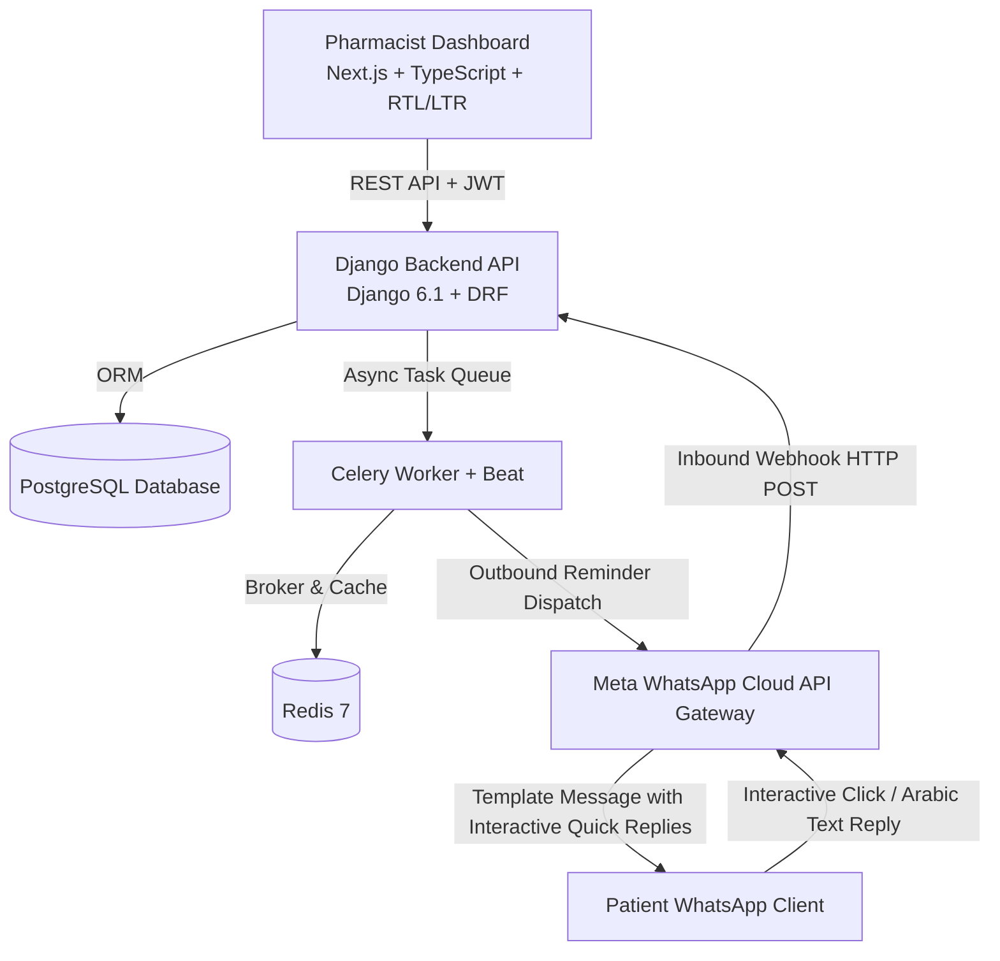

# Wesal (وِصال) — Post-Dispense Medication Follow-Up Platform with WhatsApp Integration

[](https://github.com/)
[](https://nextjs.org/)
[](https://www.djangoproject.com/)
[](https://developers.facebook.com/docs/whatsapp/cloud-api)
[](https://www.postgresql.org/)

**Wesal (وِصال)** is a production-oriented healthcare SaaS platform connecting community pharmacists with patients across Egypt and the MENA region through automated, post-dispense WhatsApp medication adherence reminders, patient response tracking, and clinical intervention workflows.

---

## 1. System Architecture



### Core Architecture Components
1. **Frontend**: Next.js 16 (React 19, TypeScript, Tailwind CSS, Lucide icons, full Arabic RTL & English LTR support).
2. **Backend**: Django REST Framework (JWT Authentication, Pharmacy tenant isolation, strict permission hierarchy).
3. **Database**: PostgreSQL (production) with automatic fallback to SQLite for local zero-dependency testing.
4. **Job Queue & Scheduling**: Celery + Redis with pre-send reconciliation, idempotency checking, and quiet hours enforcement (`22:00` to `08:00` local Egypt time).
5. **Messaging Service**: Official Meta WhatsApp Business Platform Cloud API client with HMAC SHA-256 signature verification and interactive quick-reply parsing.

---

## 2. Meta WhatsApp Business Cloud API Integration

Wesal interacts exclusively with the **Official Meta WhatsApp Business Cloud API**. Unofficial scraping or personal WhatsApp Web automation is strictly prohibited.

### Required Environment Variables

| Variable | Description | Example |
| :--- | :--- | :--- |
| `WHATSAPP_ACCESS_TOKEN` | System User Permanent Access Token with `whatsapp_business_messaging` permission | `EAABw...` |
| `WHATSAPP_PHONE_NUMBER_ID` | WhatsApp Business Phone Number ID | `100000000000001` |
| `WHATSAPP_BUSINESS_ACCOUNT_ID` | WhatsApp Business Account (WABA) ID | `200000000000002` |
| `WHATSAPP_VERIFY_TOKEN` | Secret verify token used during Meta webhook challenge handshake | `wesal_webhook_verify_token_2026` |
| `WHATSAPP_APP_SECRET` | Meta App Secret for verifying `X-Hub-Signature-256` HMAC header | `a1b2c3d4e5f6...` |
| `WHATSAPP_API_VERSION` | Graph API Version | `v21.0` |
| `WHATSAPP_DEFAULT_TEMPLATE_NAME` | Approved Template Name | `wesal_medication_reminder` |
| `WHATSAPP_DEFAULT_LANGUAGE_CODE` | Language code | `ar` |
| `WHATSAPP_MOCK_MODE` | Set `True` to use built-in simulator when credentials are not yet live | `False` |

---

### Step-by-Step Meta Developer Setup Guide

1. **Create a Meta Developer Account**:
   - Go to [developers.facebook.com](https://developers.facebook.com/) and register.
2. **Create a Meta App**:
   - Select **Other** > **Business** app type.
   - Name the app `Wesal Medication Reminder Platform`.
3. **Add WhatsApp Product**:
   - Under Add Products to Your App, click **Set Up** on **WhatsApp**.
4. **Register a Phone Number**:
   - In WhatsApp > API Setup, link a real business landline or mobile number (or use Meta's sandbox test number for development).
5. **Configure the Webhook**:
   - Under **WhatsApp > Configuration**:
     - **Callback URL**: `https://api.yourdomain.com/api/messaging/webhook/`
     - **Verify Token**: Match the value in `WHATSAPP_VERIFY_TOKEN` (e.g. `wesal_webhook_verify_token_2026`).
   - In **Webhook Fields**, subscribe to `messages`.
6. **Generate a Permanent System User Token**:
   - In Meta Business Manager > System Users, create a system user with `Admin` access, assign the WhatsApp account asset with Full Control, and generate a token with permissions:
     - `whatsapp_business_messaging`
     - `whatsapp_business_management`
7. **Create and Submit Message Templates**:
   - Go to WhatsApp Manager > Message Templates.
   - Create a template named `wesal_medication_reminder`:
     - **Category**: `UTILITY`
     - **Language**: `Arabic (ar)`
     - **Body Text**:
       ```text
       السلام عليكم {{1}} 👋

       حان موعد التذكير بالدواء المسجل في نظام وِصال.

       يرجى تسجيل ردك من الخيارات المتاحة.
       ```
     - **Buttons (Quick Replies)**:
       1. Button 1: `تم أخذ الدواء` (Payload: `BTN_TAKEN`)
       2. Button 2: `أخذته متأخرًا` (Payload: `BTN_TAKEN_LATE`)
       3. Button 3: `لم آخذه` (Payload: `BTN_MISSED`)

---

## 3. Patient Response Classification & Follow-Up Rules

Inbound WhatsApp text messages and interactive button replies are classified into stable internal codes:

| Button Payload / Arabic Keywords | Normalized Code | Clinical Action |
| :--- | :--- | :--- |
| `BTN_TAKEN`, `تم`, `اخذت`, `تمام` | `taken` | Reminder marked as `responded`. Adherence recorded. |
| `BTN_TAKEN_LATE`, `متاخر`, `متأخر` | `taken_late` | Recorded with timestamp offset. |
| `BTN_MISSED`, `لم اخذ`, `ما اخدت`, `نسيت` | `missed` | Recorded. If $\ge 2$ missed in 7 days $\rightarrow$ Auto-generates **High Priority Follow-Up Case**. |
| `BTN_REMIND_LATER`, `ذكرني`, `لاحقا` | `remind_later` | **Snooze Engine**: Schedules follow-up reminder 60 minutes later (respecting quiet hours). |
| `BTN_PROBLEM`, `مشكلة`, `تعب`, `الم`, `دوخة` | `problem` | **Urgent Follow-Up Case**: Flags case for immediate pharmacist contact & triage. |
| Unrecognized free-form text | `unknown` | Flagged for pharmacist manual review; does not corrupt medication schedule. |

---

## 4. Local Development Quickstart

### Prerequisites
- Python 3.12+ (or 3.14)
- Node.js 18+ and npm
- (Optional) Docker & Docker Compose

### 1. Clone & Configure Environment
```bash
git clone https://github.com/your-org/wasalh.git
cd wasalh
cp .env.example .env
```

### 2. Backend Setup
```bash
cd backend
python -m pip install -r requirements.txt
python manage.py migrate
python manage.py seed_demo_data
python manage.py test wesal_backend
python manage.py runserver 8000
```

> **Default Seed Accounts**:
> - **Platform Admin**: `admin@wesal.care` / `adminpassword123`
> - **Pharmacist**: `pharmacist@wesal.care` / `pharmacist123`

### 3. Frontend Setup
```bash
cd ../frontend
npm install
npm run dev
```
Access the application at `http://localhost:3000`.

---

## 5. One-Click Deployment to Render from GitHub

Wesal is pre-configured with a [`render.yaml`](file:///d:/projects/WASALH/render.yaml) Blueprint for instant deployment of the PostgreSQL Database, Django Backend, and Next.js Frontend.

### Step-by-Step Render Deployment:

1. **Push your code to GitHub**:
   ```bash
   git init
   git add .
   git commit -m "Initial commit of Wesal Healthcare Platform"
   git remote add origin https://github.com/YOUR_USERNAME/WASALH.git
   git push -u origin main
   ```

2. **Connect to Render**:
   - Go to [dashboard.render.com](https://dashboard.render.com/).
   - Click **New +** > **Blueprint**.
   - Connect your GitHub repository `WASALH`.
   - Render will detect `render.yaml` and provision:
     - **Database**: `wesal-postgres` (Managed PostgreSQL)
     - **Web Service**: `wesal-backend` (Django REST API running on Gunicorn + Whitenoise)
     - **Web Service**: `wesal-frontend` (Next.js App Router)
   - Click **Apply**.

3. **Configure Environment Variables in Render Dashboard**:
   - In `wesal-backend`, add your live Meta WhatsApp credentials:
     - `WHATSAPP_ACCESS_TOKEN`
     - `WHATSAPP_PHONE_NUMBER_ID`
     - `WHATSAPP_BUSINESS_ACCOUNT_ID`
     - `WHATSAPP_APP_SECRET`
   - In `wesal-frontend`, set:
     - `NEXT_PUBLIC_API_URL` = `https://wesal-backend.onrender.com/api`

4. **Register Webhook with Meta**:
   - In [Meta Developer Portal](https://developers.facebook.com/apps/):
     - **Callback URL**: `https://wesal-backend.onrender.com/api/messaging/webhook/`
     - **Verify Token**: `wesal_webhook_verify_token_2026`

---

## 6. Dockerized Turnkey Deployment

To start the entire production-like cluster (PostgreSQL + Redis + Celery + Django + Next.js) locally:
```bash
docker compose up -d --build
```
- **Web Application**: `http://localhost:3000`
- **Django REST API**: `http://localhost:8000/api`

---

## 6. Automated Testing Suite

The platform includes a comprehensive test suite in [backend/wesal_backend/tests.py](file:///d:/projects/WASALH/backend/wesal_backend/tests.py) covering all 17 core acceptance criteria:

```bash
cd backend
python manage.py test wesal_backend
```

**Verified Test Scenarios**:
1. Pharmacist login and JWT token issuance.
2. Pharmacy tenant isolation (pharmacists cannot view another pharmacy's patient records).
3. Patient creation, consent logging, and **consent withdrawal** (which automatically cancels pending reminders).
4. Medication creation and dynamic schedule synchronization.
5. Reminder scheduling and idempotency (duplicate prevention).
6. Medication status updates (`paused`, `discontinued`, `completed`) with automated reminder invalidation.
7. Meta Webhook challenge verification handshake.
8. Duplicate inbound webhook handling idempotency.
9. Interactive quick-reply button classification.
10. Egyptian Arabic free-form text keyword classifier.
11. Urgent Follow-Up case creation on medication problem report.
12. Pharmacist intervention recording and case closure.
13. CSV export permissions and UTF-8 BOM encoding for Arabic Excel compatibility.

---

## 7. Database Backup and Disaster Recovery

### Automated PostgreSQL Backup Script
```bash
#!/bin/bash
# scripts/backup_db.sh
BACKUP_DIR="/var/backups/wesal"
TIMESTAMP=$(date +"%Y%m%d_%H%M%S")
mkdir -p $BACKUP_DIR

pg_dump -U wesal_user -h localhost -F c wesal_db > "$BACKUP_DIR/wesal_backup_$TIMESTAMP.dump"

# Retain 30 days of rolling backups
find $BACKUP_DIR -name "wesal_backup_*.dump" -mtime +30 -delete
```

### Database Recovery
```bash
pg_restore -U wesal_user -h localhost -d wesal_db -c /var/backups/wesal/wesal_backup_20261010_010000.dump
```

---

## 8. Security & Privacy Safeguards

- **Access Token Masking**: Tokens and API secrets are never returned in client API responses.
- **Tenant Isolation**: Database queries enforce pharmacy-level scoping on all viewsets.
- **HMAC SHA-256 Webhook Verification**: Rejects spoofed or unsigned incoming webhook calls.
- **Quiet Hours Policy**: Strict block on outbound messages between `22:00` and `08:00` (Egypt local time).
- **Pre-Send Re-verification**: Even if a reminder was scheduled, the engine checks active consent, enrollment status, and active medication status before issuing the Meta Cloud API call.
- **No Unnecessary PHI in Messages**: Generic, privacy-preserving reminder text is used by default.

---

## 9. Itemized External Dependencies & Operational Costs

| Component | Provider | Expected Monthly Cost |
| :--- | :--- | :--- |
| WhatsApp Cloud API (Utility Templates) | Meta Business Platform | First 1,000 service conversations/month free; approx. $0.015–$0.025 per utility conversation thereafter in Egypt |
| Production Server / VPS (4 CPU, 8GB RAM) | DigitalOcean / Hetzner / AWS | $20 – $40 / month |
| Managed PostgreSQL & Redis | VPS or Cloud Managed | $15 – $30 / month |
| SSL / CDN | Cloudflare | Free tier included |
